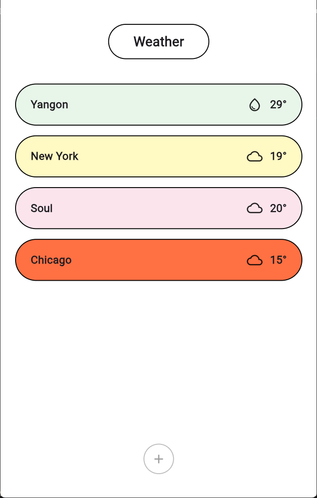

# Flutter Developer Portfolio — One Page Website

A single-page, dependency-free portfolio site for a Flutter developer.
Dark/light theme, scroll animations, filterable project grid and a working contact form.

## Files

```
flutter-portfolio/
├── index.html          # all content & sections
├── styles.css          # theme variables live in :root
├── script.js           # reveal, counters, filters, typing, form, copy-email
├── resume.pdf          # linked from the hero
├── images/
│   ├── icons/          # favicon.svg, favicon-32.png, apple-touch-icon.png
│   ├── logo/           # logo-128.jpg (nav mark) + logo.jpg, logo-alpha-64.png sources
│   └── weather_app/    # screenshots shown on the Weather Watchlist card
├── AGENTS.md           # notes for AI agents and future you
├── test-chip-drag.js   # headless test for the hero chips: node test-chip-drag.js
└── README.md
```

## Run it

Double-click `index.html`, or serve it locally (recommended, keeps localStorage behaviour clean):

```powershell
cd "D:\Mobile class\flutter_class\flutter-portfolio"
python -m http.server 8000
# open http://localhost:8000
```

## Make it yours

| What | Where |
| --- | --- |
| Name, title, socials | `index.html` — `<title>`, hero `<h1>`, `.social-row` |
| Bio, stats, experience | `index.html` — `#about`, `.stats`, `#experience` |
| Projects | `index.html` — `.project` cards. `data-cat="mobile\|web\|package"` drives the filters |
| Project screenshots | `index.html` — the `.project-thumb` thumb. See "Project thumbnails" below |
| Skill bars | `index.html` — `data-level="95"` on each `.meter` |
| Contact details | `index.html` — `#contact` |
| Copy-email button | `index.html` — the `.contact-email` card. `data-copy` on `.copy-btn` must match the `mailto:` address |
| Colours, fonts, spacing | `styles.css` — `:root` custom properties |
| Form submission | `script.js` — the `CONTACT_ENDPOINT` constant, section 10 |

### Project thumbnails

Four of the five cards preview **real app screenshots**. Add `is-shots` to the thumb and fill a
`.thumb-shots` overlay:

```html
<div class="project-thumb is-shots t-5">
  <div class="thumb-shots">
    
    <!-- 1, 2 or 3 shots; they scale to fit -->
  </div>
</div>
```

Keep the `.t-N` class — it becomes the dark tinted backdrop behind the shot, so pick one that suits
the app. Put the files in `images/<app-name>/`. There are three layouts:

- **Shelf** (default — Weather, Mari): shots sit bottom-flush, each takes an equal share and is
  capped by the panel height, so even a very tall 0.47-ratio phone shot fits.
- **`.is-mixed`** (Mini-Blog): two wide web shots stacked above two phone shots, for a card that is
  both web and mobile. Shots go inside `.shot-row.is-wide` / `.shot-row.is-tall`.
- **`.is-fan`** (Yomi): a tilting, overlapping deck of three. It only becomes a deck inside the
  desktop split query where the panel is tall; elsewhere it falls back to the shelf.

The fifth card, `curved_toggle_tabs`, has no app UI worth shooting, so it keeps a **coded HTML/CSS
mockup** — a small scene inside `<div class="project-thumb t-4">` describing the package: a
folder-style tab bar (`.mock.mock-tabs`) whose indicator morphs across the row on hover.

### The bento grid

The five cards are laid out as a bento grid rather than a uniform row: on desktop the grid is three
columns and `Yomi Board` spans two of them (`.wide`) with its copy and visual side by side
(`.split`). Tablet drops to two columns, mobile to one. One class drives all of it — add `.wide` to
whichever card should span two columns.

Filtering is handled by `script.js` §9, which adds `.filtered` to `#projectsGrid` whenever a
category other than **All** is active. That switches the grid to a centred `auto-fit` layout so
one or two surviving cards don't stretch across the page. Keep the `#projectsGrid` id and the
`.filtered` toggle together — the bento span and the split only apply while `.filtered` is absent.

Badges (`.p-badge`) and footer buttons (`.pl-primary` for a filled CTA, `.pl-src` for a text link
with a sliding arrow) are plain markup inside each card — edit the text, or the `href`, in place.

### The contact form

It is already wired: `script.js` (section 10) POSTs the three fields to **FormSubmit**, a free
no-signup relay that emails you the submission — which is how the site stays backend-free.

**One-time step:** the *first* submission triggers a confirmation email to your address. Click the
link in it. Until you do, the relay refuses every submission and the form shows its error message.
After confirming, FormSubmit offers a random alias you can use instead of your raw address — swap it
into `CONTACT_ENDPOINT` to keep your address out of the source.

`success` comes back as the **string** `"true"`, and FormSubmit answers HTTP 200 even when it
refuses. Compare with `String(data.success) !== 'true'` (as the handler does) — `if (res.ok)` would
show a false success, because `"false"` is truthy in JS.

To use a different service, change the one `CONTACT_ENDPOINT` constant; the rest is unchanged:

| Service | Endpoint |
| --- | --- |
| FormSubmit (current) | `https://formsubmit.co/ajax/you@example.com` |
| Formspree | `https://formspree.io/f/<your-id>` |
| Web3Forms | `https://api.web3forms.com/submit` (add your `access_key` to the body) |

### Re-theme

Edit the `:root` block at the top of `styles.css` — every colour, the gradient and both
font stacks are defined there. The light theme is a single `html[data-theme="light"]` override.

## Deploy

It's a static site — no build step. This copy is deployed on **Vercel**, wired to the
[`PhooPwintSone/flutter-portfolio`](https://github.com/PhooPwintSone/flutter-portfolio) repo: push to
`master` and Vercel rebuilds. Live at <https://flutter-portfolio-hazel.vercel.app/>.

Any other static host works too (GitHub Pages, Netlify, Cloudflare Pages) — just drop the folder in.
The one host-specific piece is the Vercel Analytics snippet at the end of `<head>`: it is guarded on
`location.hostname` so it no-ops elsewhere, but delete the block if you move off Vercel.
